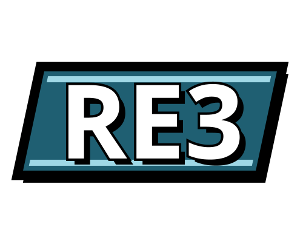
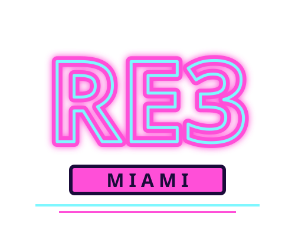
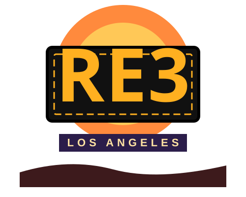

<h1 align="center">Re3 Redux</h1>

<p align="center">A Rust rewrite of Re3, re3 Miami and Re3 LA.</p>

<p align="center">
  
  
  
</p>

One engine, one `main` branch, three releases: **Re3**, **re3 Miami** and **Re3 LA**. Each release ships its own build, tagged `re3-v…`, `re3-miami-v…` and `re3-la-v…`. The goal is a fully working, moddable, cross-platform (Linux and Windows) version of the original PC games that can be enjoyed for years to come.

This is a **port of the re3 / reVC source code**, not a clean-room rewrite. The behaviour, data layouts and structure follow the reverse-engineered C++ closely, and the Rust code is checked against the real game files. All credit for the reverse engineering belongs to the people listed below.

It was written with [Claude Code](https://claude.com/claude-code), using the REA (reverse-engineer-anything) and Ponytail skills.

## Screenshots

These are from the original C++ build of re3, which is what this project is working toward.


## Status

Work proceeds bottom-up, one piece at a time. See [`PLAN.md`](PLAN.md) for the full plan.

| Done | What |
|---|---|
| Game file formats | archives, text and data files, models (DFF), textures (TXD), collision (COL), animations (IFP), text (GXT) |
| Math | the game's matrix, quaternion and rectangle types |
| Collision | all shape tests and line, sphere and model queries |
| Animation | keyframe playback, blending, animation groups |
| Model registry | every object, vehicle and ped, loaded from the game's map files |
| Pools | the handle system the game uses for entities |

Next: entities and physics, vehicles, weapons, peds and the mission script, saves, audio, then the renderer and main loop. There is no playable build yet.

## Requirements

- You **must own the original games**: GTA III for Re3, GTA Vice City for re3 Miami and GTA San Andreas for Re3 LA (not the Definitive Editions). This repository contains no game files, and none are needed to build it.
- A recent stable Rust toolchain.

## Building and testing

```
cargo build --workspace
cargo test --workspace
```

Tests that read real game files are skipped unless you point them at your installs:

```
GTA3_DIR="/path/to/Grand Theft Auto 3" VC_DIR="/path/to/Grand Theft Auto Vice City" cargo test --workspace
```

Some Rust source files are generated from the original C++ tables (animation groups, model indices, name lists). The generators are in `tools/`.

## Contributing

Issues and pull requests go through GitHub.

## Credits

This project stands on the work of the re3 and reVC team: aap (the original author), Fire_Head, shfil, erorcun, Nick007J and Serge, and everyone who contributed to [re3](https://github.com/GTAmodding/re3) and [librw](https://github.com/aap/librw). re3 started in spring 2018 as a way to test reversed collision and physics code inside the game, became a standalone executable in April 2020, and reVC followed in 2020. re3 was later removed from GitHub; this project builds on what it left behind.

## Disclaimer

This repository has **no licence**. It is derived from re3, whose authors did not feel in a position to license it. It is intended for education, documentation and modding. It is not intended for piracy or commercial use. If you build on it, please keep your work open and give proper credit.

Grand Theft Auto is a trademark of Take-Two Interactive and Rockstar Games. This project is not affiliated with or endorsed by either company. It does not include or distribute any of their assets; you need your own copy of the original games.

I don't claim to have written the underlying game logic. This is a preservation effort, made in the hope that the games stay playable.
